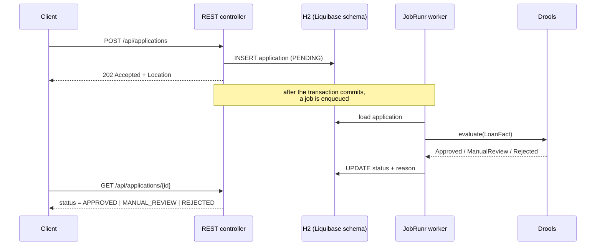

# Loan Screening — Java 21 · Spring Boot 3 · Liquibase · JobRunr · Drools

[](https://github.com/OWNER/loan-screening/actions/workflows/ci.yml)

A small, fully tested prototype that shows how to combine five technologies in a clean way.
A client submits a **loan application**; the API answers immediately (`202 Accepted`) and a
**background job** runs a **business-rules engine** that decides whether the application is
approved, needs manual review, or is rejected.

| Concern | Technology |
|---|---|
| Language / runtime | **Java 21** (records, sealed types, pattern matching, virtual threads, sequenced collections) |
| Web + persistence | **Spring Boot 3.5** (Web, Validation, Data JPA) |
| Schema migrations | **Liquibase** (Hibernate only *validates* the schema) |
| Background processing | **JobRunr 9** (one-off jobs, a recurring job, dashboard) |
| Business rules | **Drools 10** (one DRL file, four rules) |
| Tests | JUnit 5, AssertJ, Mockito, MockMvc, Awaitility, JaCoCo |

## How it works



### The business rules

Defined in [`loan-risk.drl`](src/main/resources/dev/geo/loanscreening/rules/loan-risk.drl).
Every matching rule reports a verdict; the one with the **highest salience** wins.

| Salience | Rule | Condition | Verdict |
|---|---|---|---|
| 100 | Reject – credit score | score < 500 | `REJECTED` |
| 100 | Reject – loan too large | loan > 10 × annual income | `REJECTED` |
| 50 | Manual review | score < 650 **or** loan > 5 × income | `MANUAL_REVIEW` |
| 10 | Approve | score ≥ 650 **and** loan ≤ 5 × income | `APPROVED` |

## Java 21 features used (and where)

| Feature | Where |
|---|---|
| **Sealed interface + records** | [`Decision`](src/main/java/dev/geo/loanscreening/domain/Decision.java) — closed set of outcomes |
| **Pattern matching for `switch`** (exhaustive, no `default`) | `Decision.status()` |
| **Record patterns** | `Decision.summary()` — `case Approved(var reason) -> ...` |
| **Sequenced collections** (`getFirst()`, `getLast()`, `reversed()`) | [`DecisionCollector`](src/main/java/dev/geo/loanscreening/rules/DecisionCollector.java) |
| **Virtual threads** | `spring.threads.virtual.enabled=true` (Tomcat); JobRunr workers also use them; the thread-safety test in `LoanRiskRuleEngineTest` runs 1,000 evaluations on virtual threads |
| `Math.clamp` (new in 21) | `LoanApplicationService.recent` |
| Records as DTOs, config and Drools facts | `SubmitLoanRequest`, `ScreeningProperties`, `LoanFact` |
| Text blocks | tests (JSON bodies, CSV tables) |

> Java 21 *preview* features (string templates, unnamed patterns) are intentionally **not** used,
> so the project builds without `--enable-preview`.

## Design decisions worth reading

- **Async by design.** The HTTP call never waits for the rules; it returns `202` and a `Location`.
- **Enqueue after commit.** `@TransactionalEventListener(AFTER_COMMIT)` guarantees the job cannot
  start before the row is visible.
- **Idempotent jobs.** JobRunr is *at-least-once*. Evaluation skips applications that already have a
  verdict, and the job id is derived from the application id, so duplicates are impossible.
- **Safety net.** A recurring job (`PendingApplicationSweeper`) re-schedules applications stuck in
  `PENDING` (e.g. the app crashed between commit and enqueue).
- **Rules are isolated.** Drools only sees an immutable `LoanFact` record, never the JPA entity.
  The DRL is compiled once at startup (a broken rule fails the boot, not a request), and each
  evaluation uses its own stateless session, so it is safe under concurrency.
- **Liquibase owns the schema.** `ddl-auto=validate` makes Hibernate fail fast on drift.
- **Time is injected** (`Clock`), keeping domain and services deterministic in tests.

## Project layout

```
src/main/java/dev/geo/loanscreening
├── domain/    entity, repository, sealed Decision, status enum
├── rules/     Drools adapter (LoanRiskRuleEngine), LoanFact, DecisionCollector
├── service/   use cases (submit / query / evaluate) and the domain event
├── jobs/      JobRunr job, scheduler (after-commit) and recurring sweeper
├── web/       REST controller, DTO records, RFC 9457 error handling
└── config/    Clock bean, typed configuration properties
src/main/resources
├── application.yml
├── db/changelog/                     Liquibase master + versioned changes
└── dev/geo/loanscreening/rules/      loan-risk.drl
```

## Getting started

**Requirements:** JDK 21 (the Maven wrapper is included, no Maven install needed).

```bash
./mvnw spring-boot:run
```

- API: <http://localhost:8080/api/applications>
- JobRunr dashboard: <http://localhost:8000> (watch jobs and the recurring sweeper run)

### Try it

```bash
# 1. Submit (returns 202 + Location header, status PENDING)
curl -i -X POST localhost:8080/api/applications \
  -H 'Content-Type: application/json' \
  -d '{"applicantName":"Ada Lovelace","annualIncome":60000,"requestedAmount":15000,"creditScore":720}'

# 2. A few seconds later the job has run the rules
curl localhost:8080/api/applications/<id>

# 3. List the newest applications
curl 'localhost:8080/api/applications?limit=10'
```

| Method | Path | Description |
|---|---|---|
| `POST` | `/api/applications` | Submit an application (`202 Accepted`) |
| `GET` | `/api/applications/{id}` | Read one application and its decision |
| `GET` | `/api/applications?limit=20` | Newest first, `limit` clamped to 1–100 |

Validation errors and `404`s are returned as `application/problem+json`.

> The prototype uses an **in-memory H2** database (PostgreSQL mode): data is lost on restart.
> JobRunr creates its own `jobrunr_*` tables automatically.

## Tests

```bash
./mvnw verify          # unit + integration tests + JaCoCo report (target/site/jacoco/index.html)
```

| Level | Class | What it proves |
|---|---|---|
| Rules | `LoanRiskRuleEngineTest` | Every rule and boundary through the real Drools engine; priority; thread-safety on virtual threads |
| Domain | `DecisionTest`, `LoanApplicationTest`, `DecisionCollectorTest` | Sealed-type mapping, invariants, sequenced collection behaviour |
| Service | `LoanApplicationServiceTest` | Submit/evaluate/idempotency with mocks and a fixed clock |
| Jobs | `PendingApplicationSweeperTest`, `LoanEvaluationSchedulerTest` | Sweeper selection logic, deterministic job ids |
| Web slice | `LoanApplicationControllerTest` | Status codes, `Location`, validation, 404 problem details |
| End to end | `LoanScreeningIntegrationTest` | Real HTTP → Liquibase schema → JobRunr → Drools → persisted verdict |

CI runs the same command on every push and pull request
([workflow](.github/workflows/ci.yml)).

## Ideas for next steps

- Switch to PostgreSQL (add the driver and a Docker Compose file; the Liquibase changelog is portable).
- Load rules from a database or Git instead of the classpath (hot reload with a new `KieBase`).
- Add authentication, metrics (Micrometer) and OpenAPI documentation.

## License

[MIT](LICENSE)
